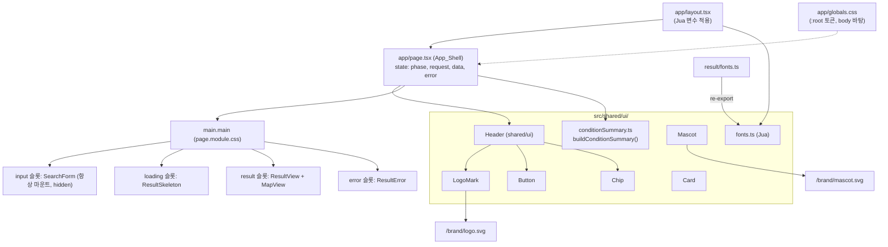
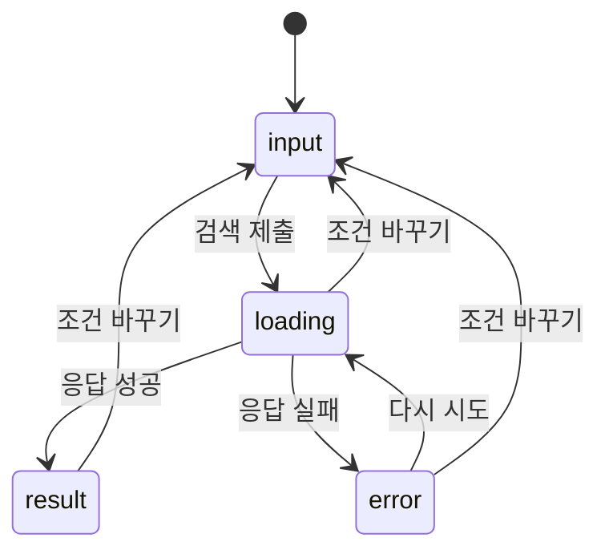

# 설계 문서: 앱 셸과 공통 UI (app-shell-shared-ui)

## Overview

목업 5장을 병렬로 구현하기 전에 필요한 공통 기반을 만든다. 내용은 세 가지다.

1. **공용 토큰과 글꼴**: 색, 모서리, 간격을 `:root`에, Jua를 앱 전체에 연결한다.
2. **공통 컴포넌트** `src/shared/ui/`: `Button`, `Card`, `Chip`, `LogoMark`, `Mascot`, `Header`.
3. **앱 셸** `app/page.tsx`: Header + 네 단계(`input`, `loading`, `result`, `error`) 중 하나를 보이는 화면 전환.

설계 방침:

- **기존 컴포넌트는 그대로 둔다.** `SearchForm`, `ResultSkeleton`, `ResultView`, `ResultError`, `MapView`는 새 Header 아래에 그대로 배치한다. 각 화면의 목업 구현은 이 spec 뒤에 병렬로 한다(요구사항 7.10).
- **공통 UI는 `src/shared/ui/`에 둔다.** `structure.md`의 규칙 1(기능 폴더끼리 import 금지)을 지키면서 모든 기능 폴더가 쓸 수 있는 유일한 위치다. ESLint `FEATURES` 목록에 없으므로 설정 변경이 필요 없다.
- **각 컴포넌트는 CSS Module로 자기 스타일을 완결한다.** 전역 `button`, `main`, `.card` 규칙이 남아 있어도 영향받지 않도록 모든 속성을 직접 지정한다.
- **병렬 작업의 충돌 면적을 줄인다.** `app/page.tsx`는 단계마다 한 줄(슬롯)로 구성하고, 각 화면 담당자는 자기 컴포넌트 파일만 고친다.

### 조사 결과 (설계에 반영한 사실)

| 항목 | 확인한 내용 | 설계 반영 |
|---|---|---|
| SVG 두 개 | `public/brand/mascot.svg`(2.4KB), `logo.svg`(2.9KB). 640×640 `viewBox`, 래스터 `<image>` 없음, 각각 `<title>`, `<desc>` 포함 | ``로 불러온다. 파일이 작고 정적이라 인라인 SVG나 최적화가 필요 없다. ``는 두 SVG의 `id`(`shadow`, `softShadow`)가 한 페이지에서 충돌하는 문제도 피한다 |
| `next/image`와 SVG | `next/image`는 SVG를 기본으로 최적화하지 않고 `dangerouslyAllowSVG`를 요구한다 | `next/image`에 `unoptimized`를 주거나 일반 ``를 쓴다. 설정 변경(`next.config.ts`)을 피하려고 `unoptimized` + 고정 `width`/`height`로 레이아웃 이동을 막는다 |
| 전역 CSS | `globals.css`에 `button`, `main`, `table`, `th`, `td`, `input`, `.card`, `.form`, `.field`, `.error`, `.map`, `.breakdown` 규칙이 있다 | `SearchForm`이 `.card`, `.form`, `.field`, `.error`, `button`, `input` 규칙에 의존하므로 **지우지 않는다**. `body`와 `main` 규칙만 고친다(아래 "전역 CSS 처리") |
| `button:disabled` 전역 규칙 | `button:disabled { opacity: 0.6 }`의 명시도는 (0,1,1)이다. CSS Module의 `.button`(0,1,0)보다 높다 | 모듈에 `.button:disabled`(0,2,0)를 두고 `opacity`와 `cursor`를 명시한다. 그러지 않으면 비활성 상태에서 전역 규칙과 겹쳐 두 번 흐려진다 |
| 현재 `fonts.ts` | `next/font/google`의 `Jua`를 `result/fonts.ts`에서만 import. `subsets: ["latin"]`이고 Next의 폰트 데이터에서 Jua가 지원하는 subset도 `latin`뿐이다 | 위치만 `shared/ui/fonts.ts`로 옮기고 설정은 유지한다. 한글 글자가 Jua로 보이는지는 구현 중 브라우저에서 확인한다(위험 요소 참고) |
| `SearchForm` 상태 | 출발지, 목적지, 도착 시각을 컴포넌트 내부 `useState`로 들고 있다. 언마운트하면 값이 사라진다 | 요구사항 7.7(조건 바꾸기 시 입력값 유지)을 위해 입력 단계가 아닐 때도 **마운트를 유지하고 `hidden`으로 감춘다**. `SearchForm`의 props를 바꾸지 않으므로 입력 화면 담당자와 충돌하지 않는다 |
| `RecommendRequest.departureTime` | 선택값이고 `SearchForm`은 보내지 않는다. 응답의 `Option.departureTime`에는 있다 | 결과 단계의 Condition_Summary는 `request.departureTime ?? options[0]?.departureTime`을 쓴다. 로딩, 오류 단계에서는 "출발" 부분을 생략한다(요구사항 6.4) |
| 테스트 설정 | `vitest.config.mts`가 `src/**/*.test.ts`만 포함한다 | 렌더링 테스트는 없다. 검증할 로직(Condition_Summary)을 `.ts` 순수 함수로 뽑아 테스트한다 |
| 장소 이름 | 가짜 장소 이름이 이미 "홍대입구역"처럼 "역"을 포함한다 | 요구사항 6.2는 이름을 그대로 쓴다는 뜻으로 구현한다. "역"을 붙이거나 떼지 않는다 |

## Architecture



### 화면 전환 상태 머신



- `loading`에서 "조건 바꾸기"를 누르면 진행 중인 요청을 무효로 만들고 `input`으로 간다(요구사항 7.8).
- 상태는 `page.tsx`의 `useState` 하나(`State` 유니온)로 유지한다. 기존 `State` 타입의 `idle`을 `input`으로 이름 바꾸고, 공통 `request`를 모든 단계가 가질 수 있게 확장한다.

```ts
type Phase = "input" | "loading" | "result" | "error";

type State =
  | { phase: "input" }
  | { phase: "loading"; request: RecommendRequest }
  | { phase: "result"; request: RecommendRequest; data: RecommendResponse }
  | { phase: "error"; request: RecommendRequest; message: string };
```

기존 `lastRequest` state는 `request` 필드로 흡수한다. `input`에서는 요청이 없다.

### 오래된 응답 무시 (요구사항 7.8)

`useRef<number>`로 요청 번호를 올린다. `handleSubmit`이 시작할 때 번호를 증가시켜 지역 변수에 저장하고, `await` 뒤 현재 번호와 다르면 `setState`를 하지 않는다. "조건 바꾸기"도 번호를 증가시켜 진행 중 요청을 무효로 한다. `AbortController`는 쓰지 않는다. 서버 호출을 취소할 필요는 없고 응답만 버리면 되기 때문이다.

## Components and Interfaces

모든 컴포넌트는 `src/shared/ui/`에 두고 `index.ts`로 공개 API만 내보낸다. 서버 컴포넌트로 쓸 수 있는 것(Button, Card, Chip, LogoMark, Mascot, Header)은 `"use client"`를 붙이지 않는다. 이벤트 핸들러는 부모가 클라이언트 컴포넌트에서 내려 주므로 문제없다.

### Button

```ts
interface ButtonProps extends React.ButtonHTMLAttributes<HTMLButtonElement> {
  variant?: "primary" | "outline"; // 기본 primary
  fullWidth?: boolean;
}
```

- `type` 기본값 `"button"`. 나머지 속성은 `...rest`로 `<button>`에 전달(요구사항 2.4, 2.7).
- `min-height: 44px`, `border-radius: 12px`. 모든 속성(`padding`, `border`, `background`, `font`, `color`, `opacity`, `cursor`)을 `.button` 안에서 명시해 전역 `button` 규칙을 덮는다(2.8).
- `:focus-visible { outline: 3px solid var(--primary-text); outline-offset: 2px }`. outline 버튼은 테두리와 겹치지 않도록 offset을 둔다(2.6).
- 목업의 큰 버튼(입력 화면 "택시로 갈아탈 역 찾기")은 `fullWidth`와 `size`가 필요하지만 목업의 글자 크기는 후속 화면 작업이 정한다. **`size` prop은 지금 만들지 않는다**(YAGNI).

### Card

```ts
interface CardProps extends React.HTMLAttributes<HTMLElement> {
  as?: "div" | "section" | "article"; // 기본 div
  tone?: "default" | "tint" | "alert"; // 기본 default
  padding?: "md" | "lg"; // 기본 md
}
```

- `default`: `--surface` 바탕, 1px `--border`, 16px 모서리. `tint`: `--surface-tint` 바탕. `alert`: 2px `--late` 테두리, 20px 모서리(목업의 "제시간 도착 불가" 카드).
- `className`은 `cx(styles.card, ..., className)`로 합친다(요구사항 3.5).
- 추천 카드(보라 배경, 20px)는 Card를 쓰지 않는다. 의미가 다른 컴포넌트이므로 결과 화면 담당이 만든다.

### Chip

```ts
interface ChipProps extends React.HTMLAttributes<HTMLSpanElement> {
  tone?: "primary-soft" | "primary" | "late"; // 기본 primary-soft
}
```

- 알약 모양(`border-radius: 999px`), 높이는 내용에 맞춘다. 말줄임이 필요한 곳(Header)은 부모가 `max-width`, `overflow`, `text-overflow`를 지정한다. Chip은 `min-width: 0`과 `white-space: nowrap`만 갖는다.
- `children` 필수. 아이콘만 있는 칩을 허용하지 않는다(요구사항 3.6).

### LogoMark, Mascot

```ts
interface LogoMarkProps {
  size?: number; // px, 기본 32
  decorative?: boolean; // true면 aria-hidden, alt=""
}
type MascotMood = "idle" | "happy" | "loading" | "late" | "error";
interface MascotProps {
  size?: number; // px, 기본 64
  mood?: MascotMood; // 기본 idle
}
```

- 둘 다 ``를 그린다. `src`는 `/brand/logo.svg`, `/brand/mascot.svg`. `width`, `height`에 `size`를 넣고 `style={{ width: size, height: size }}`는 쓰지 않는다. 비율은 정사각형이라 `object-fit: contain`만 CSS로 지정한다(요구사항 4.6, 4.8).
- `Mascot`은 항상 `alt=""`, `aria-hidden="true"`, `data-mood={mood}`. 지금은 `mood`가 그림을 바꾸지 않는다. 표정별 파일이 생기면 `MOOD_SRC: Record<MascotMood, string>` 표 한 곳만 고친다(요구사항 4.3).
- `LogoMark`는 `decorative`가 거짓이면 `alt="빨리갈게"`. Header에서는 옆에 텍스트 "빨리갈게"가 있으므로 `decorative`로 쓴다(4.5).
- 임시 그림 대체 단계는 필요 없다. 파일이 이미 `public/brand/`에 있다(요구사항 4.7은 만족한 상태).
- `next/image`는 쓰지 않는다. 일반 ``는 `@next/next/no-img-element` 경고를 내므로 해당 줄에 `eslint-disable-next-line`과 이유(정적 SVG, 최적화 불필요)를 주석으로 단다.

### Header

```ts
interface HeaderProps {
  /** 있으면 칩과 "조건 바꾸기" 버튼을 보인다. 입력 단계에서는 전달하지 않는다. */
  conditionSummary?: string;
  onChangeCondition?: () => void;
}
```

- `conditionSummary`가 `undefined`이면 로고와 서비스 이름만(요구사항 5.2). 문자열이면 칩과 버튼을 함께 보인다(5.3). `conditionSummary`는 있고 `onChangeCondition`이 없는 조합은 타입상 허용하되 버튼을 그리지 않는다.
- 구조: `<header class="header"><div class="inner">[LogoMark + "빨리갈게"] [Chip] <span class="spacer"/> [Button outline "조건 바꾸기"]</div></header>`. `inner`는 본문 컨테이너와 같은 최대 폭 규칙을 쓴다.
- "빨리갈게" 글자는 `font-family: var(--font-heading)`, `color: var(--primary-text)`.
- 높이는 `height: 50px`로 고정, 칩은 `min-width: 0; max-width: 100%; overflow: hidden; text-overflow: ellipsis; white-space: nowrap`. 버튼은 `flex: none`(5.6, 5.8).
- Header 안의 "조건 바꾸기" 버튼은 높이 44px 규칙(요구사항 10.1)이 Header 높이 50px 안에 들어가도록 상하 여백 3px로 한다.
- 폭 320px에서 칩이 사라지지 않도록 칩에 `flex: 0 1 auto`(줄어들 수 있음), 로고와 버튼에 `flex: none`을 쓴다.

## 순수 함수: conditionSummary.ts

```ts
export function buildConditionSummary(request: RecommendRequest, fallbackDepartureTime?: string): string;
```

- 형식: `${origin.name} → ${destination.name} · ${HH:mm}까지` + (출발 시각이 있으면 ` · ${HH:mm} 출발`).
- 출발 시각 = `request.departureTime ?? fallbackDepartureTime`. 둘 다 없으면 출발 부분을 생략한다.
- 시각 포맷은 `Intl.DateTimeFormat("ko-KR", { timeZone: "Asia/Seoul", hour: "2-digit", minute: "2-digit", hourCycle: "h23" })`. 유효하지 않은 날짜는 `Number.isNaN(date.getTime())`로 먼저 걸러 `"-"`를 돌려준다(예외를 던지지 않는다, 요구사항 6.5).
- `result/format.ts`의 `formatTime`과 로직이 비슷하지만 `shared`가 `features`를 import할 수 없어서 별도로 둔다. 중복은 20줄 이하이며, 두 곳을 합치는 일은 `format.ts`를 `shared`로 올리는 후속 리팩터링으로 미룬다(이번에는 하지 않는다).

### 정확성 속성

*속성은 모든 유효한 입력에서 참이어야 하는 성질이다.*

**Property 1: 결과 문자열의 구조.** 임의의 유효한 요청에 대해, 결과는 `"<출발지> → <목적지> · HH:mm까지"`로 시작한다. 출발 시각이 있으면 ` · HH:mm 출발`로 끝나고, 없으면 끝에 "출발"이 없다. _Validates: 요구사항 6.1, 6.4_

**Property 2: 시각 형식.** 임의의 유효한 ISO 시각에 대해 시각 부분은 `^([01]\d|2[0-3]):[0-5]\d$`를 만족하고 Asia/Seoul 기준이다(UTC 15:00은 다음 날 00:00이 아니라 `00:00`). _Validates: 요구사항 6.3_

**Property 3: 유효하지 않은 날짜는 던지지 않는다.** 임의의 문자열을 `arrivalTime`, `departureTime`에 넣어도 예외 없이 문자열을 돌려주고, 파싱할 수 없는 값은 `"-"`로 표시한다. _Validates: 요구사항 6.5_

`fast-check`는 `package.json`에 없다(수정 금지). 속성은 경계값 표(자정 직전/직후, UTC와 KST 날짜 차이, 빈 문자열, `"invalid"`, 출발 시각 있음/없음) 예시 테스트로 검증한다.

## 전역 CSS 처리

### `app/globals.css` 변경

추가:

```css
:root {
  /* 색 (design-system.md 표와 같은 값) */
  --primary: #8e44d4;       --on-primary: #ffffff;
  --primary-text: #7a35c4;  --primary-soft: #f3eafc;
  --surface-tint: #f6f2fd;  --surface: #ffffff;
  --ink: #1e1433;           --text-sub: #5e5670;
  --border: #e6ddf6;
  --ok: #16a34a;            --late: #dc2626;
  --late-soft: #fdecea;     --late-row: #6b7280;
  --subway: #2e9e4f;        --taxi: #f2a007;
  --page-bg: #f5f1fd;
  /* 모양 */
  --radius-card: 16px;  --radius-button: 12px;  --radius-hero: 20px;
  /* 간격 */
  --space-1: 4px; --space-2: 8px; --space-3: 12px;
  --space-4: 16px; --space-5: 20px; --space-6: 24px;
}
```

수정:

- `body`: `background: var(--page-bg); color: var(--ink);` (기존 `#f5f6f8`, `#1a1a1a` 대체). `font-family: system-ui, sans-serif`은 유지.
- `main` 규칙(`max-width: 640px; margin: 0 auto; padding: ...; display: grid; gap: 16px;`)은 **삭제**하고 `page.module.css`의 `.main`이 폭, 여백, 배치를 모두 정한다(요구사항 8.5).

유지(지금은 지우지 않는다): `.card`, `.form`, `.field`, `input`, `button`, `button:disabled`, `.error`, `table`, `th, td`, `tr.best`, `.map`, `.breakdown`. 입력 화면 담당자가 `SearchForm`을 새 컴포넌트로 바꾼 뒤 사용되지 않는 규칙을 지운다.

`.card`는 전역 클래스이고 새 `Card`는 CSS Module 클래스(`Card_card__hash`)라 이름이 충돌하지 않는다.

> 토큰 중복: `result.module.css`, `map.module.css`의 `.root` 선언부는 그대로 둔다. 같은 값을 다시 선언하므로 화면은 변하지 않는다(요구사항 1.4, 9.3). 정리는 후속 작업이다.

### `app/layout.tsx` 변경

```tsx
import { jua } from "@/shared/ui/fonts";
// ...
<html lang="ko" className={jua.variable}>
```

`title`, `description` 메타데이터는 이번에 바꾸지 않는다(범위 밖). 서비스 이름이 "빨리갈게"이므로 `title`을 바꾸고 싶다면 별도 작업으로 제안한다.

### `src/features/result/fonts.ts` 변경

```ts
export { jua } from "@/shared/ui/fonts";
```

`next/font/google`을 import하는 파일은 `src/shared/ui/fonts.ts` 한 곳이다. `result` 안의 기존 `import { jua } from "./fonts"`는 수정하지 않는다. `result`는 `@/shared`만 import하므로 ESLint 경계를 지킨다.

## 앱 셸: `app/page.tsx`와 `app/page.module.css`

### 구조

```tsx
"use client";
export default function HomePage() {
  const [state, setState] = useState<State>({ phase: "input" });
  const requestSeq = useRef(0);
  async function handleSubmit(request) { /* 번호 증가, loading, fetch, 번호 비교 후 result 또는 error */ }
  function handleChangeCondition() { requestSeq.current += 1; setState({ phase: "input" }); }

  const summary = state.phase === "input" ? undefined :
    buildConditionSummary(state.request, state.phase === "result" ? state.data.options[0]?.departureTime : undefined);

  return (
    <>
      <Header conditionSummary={summary} onChangeCondition={handleChangeCondition} />
      <main className={styles.main}>
        <div className="sr-only" role="status" aria-live="polite">{PHASE_ANNOUNCEMENT[state.phase]}</div>
        {/* 입력 단계 슬롯. 값 유지를 위해 항상 마운트하고 숨긴다. */}
        <div hidden={state.phase !== "input"}><SearchForm loading={state.phase === "loading"} onSubmit={handleSubmit} /></div>
        {/* 로딩 슬롯 */}
        {state.phase === "loading" && <ResultSkeleton />}
        {/* 결과 슬롯 */}
        {state.phase === "result" && (<><ResultView .../><MapView .../></>)}
        {/* 오류 슬롯 */}
        {state.phase === "error" && <ResultError message={state.message} onRetry={() => handleSubmit(state.request)} />}
      </main>
    </>
  );
}
```

- 각 슬롯은 서로 다른 줄이다. 입력, 로딩, 결과, 오류 담당자가 각자 슬롯의 JSX 한 줄만 고치므로 병합 충돌이 줄어든다.
- 기존 제목 `<h1>택시 환승역 추천</h1>`은 제거한다. Header가 서비스 이름을 보이므로 중복이다. 접근성을 위한 `<h1>`은 각 화면 담당이 화면 제목으로 넣는다(현재는 각 컴포넌트의 제목이 있다). 이번 spec에서는 `<h1>`이 없는 상태가 생기므로, 입력 단계가 `SearchForm`의 기존 모양 그대로인 동안 시각적으로 숨긴 `<h1 className="sr-only">빨리갈게</h1>`을 둔다.
- 단계 전환 알림(요구사항 10.3): `role="status" aria-live="polite"` 영역에 단계별 짧은 문구("경로를 찾는 중이에요", "결과가 나왔어요", "경로를 불러오지 못했어요", "조건을 입력해 주세요")를 넣는다. 문구는 `app/` 안에 상수로 둔다. 표시용 문구를 `*.tsx`에서 조합하지 않는다는 기존 규칙(result 한정)은 이 파일에 해당하지 않지만, 템플릿 문자열 없이 상수만 쓴다.
- `sr-only` 유틸은 `page.module.css`의 `.srOnly`로 둔다(전역 클래스 추가를 피한다).
- 오류 단계의 "조건 바꾸기"는 Header 버튼이 맡는다. 오류 카드 안의 "조건 바꾸기" 버튼은 오류 화면 담당이 목업대로 추가하며, 이를 위해 `ResultError`에 `onChangeCondition` 선택 prop을 **그 담당이 추가**한다. 이번 spec에서는 건드리지 않는다.
- 결과 단계의 지도는 기존처럼 `MapView`를 `ResultView` 아래에 둔다. 2열 배치(왼쪽 추천·내역, 오른쪽 경로 요약·지도)는 결과 화면 담당이 한다.

### 본문 컨테이너 `.main`

```css
.main {
  width: 100%;
  margin: 0 auto;
  padding: var(--space-4);           /* 모바일 좌우 16px */
  box-sizing: border-box;
  display: grid;
  gap: var(--space-4);
  min-width: 0;
  align-content: start;
  min-height: calc(100vh - 50px);    /* 바탕이 뷰포트를 덮게 (body 바탕이 이미 덮지만 높이를 맞춘다) */
}
@media (min-width: 768px)  { .main { max-width: 760px;  padding: var(--space-6) var(--space-4); } }
@media (min-width: 1024px) { .main { max-width: 1200px; padding: var(--space-6); } }
```

- 기존 `.title`, `.panel`, `.resultArea`, `.mapArea`와 1024px 두 열 규칙은 이번에 **삭제한다**. 그 두 열 배치(왼쪽 입력·결과, 오른쪽 지도)는 목업의 단계별 전체 화면 구조와 다르다. 새 구조에서는 한 단계만 보이므로 두 열이 필요 없다. 결과 화면의 2열은 결과 담당이 `result` 슬롯 안에서 만든다.
- Header의 `inner`도 같은 최대 폭 규칙을 `header.module.css`에 둔다. 두 곳의 폭 값은 `--content-max-*` 변수로 맞추지 않고 일단 같은 숫자를 쓴다(값 3개, 중복 허용).
- `<main>`은 하나만 둔다(요구사항 10.4).

## 생성/수정할 파일 목록

| 구분 | 파일 | 내용 |
|---|---|---|
| 새 파일 | `src/shared/ui/index.ts` | 공개 export |
| 새 파일 | `src/shared/ui/Button.tsx`, `button.module.css` | 버튼 |
| 새 파일 | `src/shared/ui/Card.tsx`, `card.module.css` | 카드 |
| 새 파일 | `src/shared/ui/Chip.tsx`, `chip.module.css` | 칩 |
| 새 파일 | `src/shared/ui/LogoMark.tsx`, `Mascot.tsx`, `brand.module.css` | 로고, 마스코트 |
| 새 파일 | `src/shared/ui/Header.tsx`, `header.module.css` | 헤더 |
| 새 파일 | `src/shared/ui/fonts.ts` | Jua (`next/font/google`을 쓰는 유일한 파일) |
| 새 파일 | `src/shared/ui/cx.ts` | 클래스 이름 합치기. `result/cx.ts`와 같은 코드(중복 허용) |
| 새 파일 | `src/shared/ui/conditionSummary.ts`, `conditionSummary.test.ts` | 헤더 칩 문구와 테스트 |
| 수정 | `app/globals.css` | `:root` 토큰 추가, `body` 바탕색, `main` 규칙 삭제 |
| 수정 | `app/layout.tsx` | `jua.variable` 적용 |
| 수정 | `app/page.tsx` | 단계 상태 머신, Header, 슬롯 |
| 수정 | `app/page.module.css` | `.main`, `.srOnly`. 기존 두 열 규칙 삭제 |
| 수정 | `src/features/result/fonts.ts` | `shared/ui/fonts`에서 re-export |
| 수정 | `.kiro/steering/frontend-ui.md`, `design-system.md`, `structure.md` | 요구사항 9.6 |

수정하지 않는 파일: `src/shared/types.ts`, `package.json`, `eslint.config.mjs`, `app/api/`, `src/features/{recommender,places,taxi,transit}/`, `result`와 `map`의 `*.module.css`, `SearchForm`, 기존 테스트 파일.

## 공통 파일 변경 요청

이 spec이 `workflow.md`의 "공통 파일" 규칙을 의도적으로 넘는 항목이다. 병렬 작업 시작 전에 팀에 알린다.

| # | 파일 | 변경 | 이유 |
|---|---|---|---|
| 1 | `app/globals.css` | `:root` 토큰과 `body` 바탕색 추가, `main` 규칙 삭제 | 모든 화면이 같은 토큰을 쓰려면 한 곳에 있어야 한다 |
| 2 | `app/layout.tsx` | `<html>`에 `jua.variable` | 입력, 헤더 등 결과 영역 밖에서도 제목 글꼴이 필요하다 |
| 3 | `src/features/result/fonts.ts` | re-export로 교체 | Jua 로드 위치를 하나로 유지한다 |
| 4 | `.kiro/steering/*.md` 3개 | 요구사항 9.6 | 규칙과 코드를 맞춘다. 안 고치면 AI가 옛 규칙("`globals.css` 수정 금지")을 따라 되돌린다 |

`fast-check` 설치는 이번에도 요청하지 않는다. 필요해지면 `package.json` 담당자에게 별도로 요청한다.

## 병렬 작업 시 담당 파일 (이 spec 이후)

| 작업 | 수정하는 파일 | 쓰는 공통 요소 | 건드리지 않는 곳 |
|---|---|---|---|
| A 입력 화면 | `src/features/search-form/*`, `page.tsx`의 입력 슬롯 | Button, Card, Mascot | `result/` |
| B 로딩 화면 | `result/ResultStates.tsx`의 `ResultSkeleton`(또는 새 `LoadingView.tsx`), `page.tsx`의 로딩 슬롯 | Card, Mascot | 입력, 오류 |
| C 결과 화면 | `result/ResultView.tsx`, `RecommendationCard`, `LateCard`, `BreakdownCard`, 새 `RouteSummaryCard.tsx`, `page.tsx`의 결과 슬롯 | Card, Chip, Mascot | 비교표 |
| D 비교표 | `result/ComparisonTable.tsx`, `comparison.ts` | Chip | 결과 카드 |
| E 오류 화면 | `result/ResultStates.tsx`의 `ResultError`(또는 새 `ErrorView.tsx`), `page.tsx`의 오류 슬롯 | Card, Button, Mascot | 로딩 |

B와 E는 같은 `ResultStates.tsx`를 건드리므로, **먼저 `ResultSkeleton`과 `ResultError`를 각각 별도 파일로 분리하는 작은 작업을 이 spec의 마지막 작업으로 넣는 것을 권장한다.** 이 분리는 `index.ts`의 export를 유지하면 동작을 바꾸지 않는다.

## 검증 계획

- **단위 테스트(Vitest)**: `conditionSummary.test.ts` (Property 1~3 예시 표).
- **자동 검사**: `npm run build`, `npm run lint`, `npm run typecheck`, `npm test` 통과(요구사항 9.8).
- **수동 확인** (렌더링 테스트가 없으므로):
  - 단계 전환 4가지(입력 → 로딩 → 결과, 로딩 → 오류, 오류 → 다시 시도, 결과 → 조건 바꾸기 후 입력값 유지).
  - 폭 320px, 375px, 768px, 1280px에서 가로 스크롤과 Header 한 줄 유지.
  - 키보드 Tab 순서와 포커스 표시, Button `disabled` 모양.
  - 기존 결과 화면이 변하지 않았는지 이전 스크린샷과 비교(`screens/` 폴더).
  - 한글 제목(Header "빨리갈게", 결과 카드 제목)이 Jua로 그려지는지.
- 대비 계산은 기존 토큰 값을 그대로 쓰므로 새로 검증하지 않는다. 새 값은 `--page-bg`뿐이며 글자가 올라가지 않는 바탕색이다.

## 위험 요소와 대응

| 위험 | 영향 | 대응 |
|---|---|---|
| Jua의 한글 글리프가 `latin` subset에 없어 한글이 시스템 글꼴로 나올 수 있다 | 제목이 목업과 다른 글꼴 | 구현 중 브라우저에서 확인한다. 안 되면 `subsets`에 `"korean"`을 시도하고, 타입에서 거부되면 `next/font/local`이나 `<link>`로 바꾸는 방법을 design에 추가한다. 이번 spec에서 Header 글자를 꼭 Jua로 해야 하는 것은 아니다 |
| `SearchForm`을 숨겨 마운트해 두는 방식이 입력 담당의 작업(예: 포커스, 자동완성 팝업)과 어긋남 | 숨긴 상태에서 이벤트가 남아 있을 수 있음 | `hidden`은 `display: none`이라 포커스와 클릭을 받지 않는다. 입력 담당이 `SearchForm` 상태를 위로 올리면(lift) 그때 `hidden` 방식을 걷어낸다 |
| 전역 `button`, `input` 규칙이 새 입력 화면 컴포넌트에도 영향 | 입력 화면 담당이 의도치 않은 스타일을 만남 | 입력 담당이 새 컴포넌트를 CSS Module로 완결하고, 쓰지 않는 전역 규칙을 지운다. 이 책임을 요구사항 후속 작업 목록에 둔다 |
| 전역 `main` 규칙 삭제가 다른 `<main>` 사용처에 영향 | 없음(프로젝트에서 `<main>`은 `page.tsx` 하나) | `grep -rn "<main" app src`로 구현 중 확인 |
| 헤더의 폭 규칙과 본문 폭 규칙이 어긋남 | 로고와 본문 왼쪽 끝이 어긋남 | 두 곳이 같은 3구간 값을 쓰도록 검토 항목에 둔다 |

## 범위 밖 (후속 작업)

입력 화면 목업 구현, 로딩 전체 화면(노선 진행 그림, 단계 체크), 결과 2열 배치와 "경로 요약" 카드, 오류 카드의 오류 문구 목록과 "조건 바꾸기" 버튼, 마스코트 표정별 그림, `result`와 `map`의 중복 토큰 정리, 카카오 지도.
