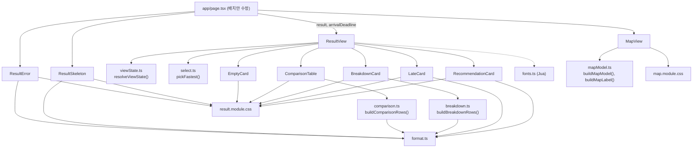
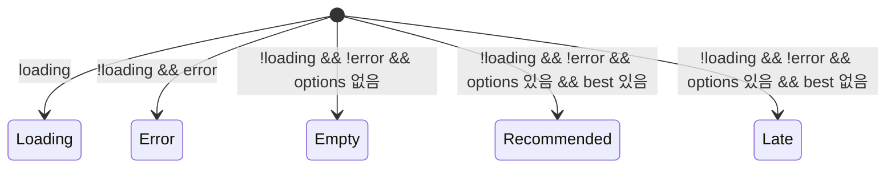

# 설계 문서: 결과 화면 디자인 적용 (result-ui-design)

## Overview

`recommend-result-ui`로 만든 결과 화면에 비주얼 디자인(색 토큰, Jua 제목 글꼴, 모양, 아이콘, 마스코트 자리)을 입힌다. 표시 상태 판별 로직, API, 데이터 타입(`@/shared/types`)은 바꾸지 않는다.

설계 방침은 다음과 같다.

- **화면에 나오는 모든 문자열은 `format.ts`가 만든다.** 요구사항 9.2가 `*.tsx`에서 템플릿 문자열, 문자열 연결, `toLocaleString`을 금지한다. 새로 필요한 문구(역 이름 정리, "N분 늦음", 시각 범위, 오류 기본 문구, "-" 대체)는 `format.ts`에 함수로 추가한다. 클래스 이름 조합은 문자열 연결이 아니라 `cx()` 헬퍼로 한다.
- **계산은 순수 함수로 뽑는다.** 표시 상태 판별, 가장 빠른 옵션 선택, 내역 행 만들기, 지도 좌표 모델은 React 없이 테스트할 수 있는 `.ts` 파일로 둔다. vitest 설정(`src/**/*.test.ts`)이 `.tsx` 렌더링 테스트를 포함하지 않기 때문이다.
- **색 값은 CSS Module 맨 위 변수 선언부에만 쓴다.** 나머지 규칙은 `var(--...)`만 쓴다.
- **기존 테스트 파일(`format.test.ts`, `recommend.test.ts`)은 한 줄도 고치지 않는다**(요구사항 9.3). 새 테스트는 새 파일에 둔다.

### 조사 결과 (설계에 반영한 사실)

| 항목 | 확인한 내용 | 설계 반영 |
|---|---|---|
| 현재 `formatTime` | `Intl.DateTimeFormat("ko-KR", {hour12:false})`. 잘못된 날짜를 넣으면 `RangeError`를 던진다 | 3.11(값 없음 → "-")을 위해 던지지 않는 `safe*` 래퍼를 추가한다. 자정 표기(`24:00`) 가능성을 막으려고 `hourCycle: "h23"`을 지정한다 |
| 현재 `formatMargin` | 60분 이상이면 "1시간 5분 늦음"으로 만든다 | 요구사항 4.4, 5.3은 "N분 늦음"(분 단위 정수)이므로 `formatLateMinutes`를 따로 둔다. `formatMargin`은 그대로 둔다 |
| 현재 `ResultView` | `options.length === 0`을 먼저 검사하고, `best ?? fastest`를 카드에 넘긴다. 정렬로 최빠른 옵션을 고른다(안정 정렬이라 동률이면 첫 번째) | 같은 우선순위를 `resolveViewState`, `pickFastest`로 뽑아 테스트 가능하게 한다 |
| 현재 `MapView` | 마커 강조를 `s.name === highlightStopName`으로 판정한다. 같은 이름의 역이 여러 노선에 있으면 마커가 여러 개 강조된다 | 요구사항 8.3(강조 마커 정확히 1개)에 맞춰 `routes` 순서상 처음 일치한 정류장 객체 하나만 강조한다 |
| `package.json` | `fast-check`가 없고, 이 스펙은 `package.json`을 고치지 않는다 | 속성 기반 테스트는 `fast-check`가 필요하다. "공통 파일 변경 요청 1"을 참고한다 |
| 디자인 토큰 값 | `.kiro/steering/design-system.md`의 표 | 값은 그 표를 그대로 쓴다. 표에 없는 보조 값은 같은 선언부에 추가한다(아래 토큰 표) |
| Jua | `next/font/google`은 `weight: "400"`만 있는 폰트도 지원한다. `variable` 옵션으로 CSS 변수에 연결하고 `display: "swap"`을 쓰면 로딩 전에 대체 글꼴로 텍스트가 보인다 | `fonts.ts`에서 로드하고, `font-family`에 대체 글꼴을 이어 쓴다(1.11) |

## Architecture



### 표시 상태 판별 (동작 유지)

`app/page.tsx`의 상태(`idle | loading | error | success`)는 그대로 둔다. 결과 영역 안에서는 아래 우선순위로 상태를 정한다. 이 순서는 현재 동작과 같다.



`best`가 있어도 `options`가 비어 있으면 Empty다(현재 `ResultView`가 `options.length === 0`을 먼저 검사하기 때문). `resolveViewState`는 이 우선순위를 코드로 고정하고, 4개 값의 16가지 조합 표로 테스트한다.

## Components and Interfaces

### 파일 구성

| 파일 | 구분 | 역할 |
|---|---|---|
| `src/features/result/fonts.ts` | 생성 | `next/font/google`로 Jua 로드. `jua.variable` 클래스와 `--font-heading` 변수 |
| `src/features/result/cx.ts` | 생성 | 클래스 이름 조합 헬퍼 `cx(...)` (falsy 값 무시) |
| `src/features/result/viewState.ts` | 생성 | `resolveViewState` |
| `src/features/result/select.ts` | 생성 | `pickFastest`, `isSameOption` |
| `src/features/result/breakdown.ts` | 생성 | `buildBreakdownRows` |
| `src/features/result/comparison.ts` | 생성 | `buildComparisonRows` (행별 늦음 여부, 배지 종류) |
| `src/features/result/format.ts` | 수정(추가만) | 새 문구 함수. 기존 export는 시그니처 유지 |
| `src/features/result/icons.tsx` | 생성 | 인라인 SVG 아이콘(`CheckIcon`, `AlertIcon`, `PinIcon`, `ClockIcon`). 항상 `aria-hidden="true"` |
| `src/features/result/ResultView.tsx` | 수정 | 상태 분기를 `resolveViewState`로, 루트에 `jua.variable` |
| `src/features/result/RecommendationCard.tsx` | 수정 | 추천 카드(추천 있음 전용). 마스코트 자리 오른쪽 |
| `src/features/result/LateCard.tsx` | 생성 | 제시간 도착 불가 카드. 마스코트 자리 왼쪽 |
| `src/features/result/BreakdownCard.tsx` | 생성 | 지하철/택시 대기/택시/합계 4행 카드 |
| `src/features/result/ComparisonTable.tsx` | 수정 | 배지, 늦음 표시, `data-label` |
| `src/features/result/ResultStates.tsx` | 수정 | `ResultSkeleton`, `ResultError`, `EmptyCard` |
| `src/features/result/index.ts` | 확인 | 기존 export 유지 |
| `src/features/result/result.module.css` | 수정 | 토큰 선언부 + 전체 모양 |
| `src/features/map/MapView.tsx` | 수정 | 택시 점선, 단일 강조 마커, CSS Module 사용 |
| `src/features/map/mapModel.ts` | 생성 | `buildMapModel`, `buildMapLabel` |
| `src/features/map/map.module.css` | 생성 | 지도 카드, 색 토큰 선언부 |
| `app/page.tsx` | 수정(배치만) | 결과 영역 JSX 구조, `app/page.module.css` 클래스 |

`app/globals.css`, `app/layout.tsx`, `src/shared/types.ts`, `package.json`, `src/features/{recommender,places,taxi,transit}/`, `app/api/`는 수정하지 않는다. 기존 `result` 컴포넌트가 이미 `@/shared/types`의 타입만 props로 받으므로 이 규칙(9.4)을 유지한다.

### 화면 구성

```
추천 있음                                   제시간 도착 불가
┌ 추천 카드 (--primary, 20px) ──────────┐   ┌ 늦음 카드 (흰색, 2px --late, 20px) ──┐
│ (추천 · 제시간 도착 중 가장 싼 방법)    │   │ [64px]  (제시간 도착 불가)            │
│ 신도림역에서 택시로 갈아타세요   [64px] │   │         제시간에 도착하는 방법이 없어요 │
│ 09:57 도착 · 3분 여유 · 21,350원       │   │         홍대입구역 · 09:49 · 4분 늦음  │
└────────────────────────────────────────┘   └───────────────────────────────────────┘
┌ 내역 카드 (흰색, 1px --border, 16px) ─┐    (내역 카드, 비교표는 동일)
│ ▌지하철   09:12 → 09:28   16분  1,550원│
│ ▌택시 대기                 5분      0원│
│ ▌택시     09:33 → 09:57   24분 약19,800원 교통상황에 따라 변동
│ 합계                       45분 21,350원│  ← 합계 금액 --primary-text, 가장 큰 글자
└────────────────────────────────────────┘
┌ 역별 비교 ────────────────────────────┐
│ (추천) 신도림 …            ← --primary-soft + 왼쪽 4px --primary
│ 사당 … 4분 늦음             ← --late-row 글자, "4분 늦음"만 --late
└────────────────────────────────────────┘
```

로딩, 오류 카드는 왼쪽에 64px 마스코트 자리를 두고, 빈 결과 카드(Empty_Card)에는 자리를 두지 않는다(요구사항 10에 포함되지 않음). 빈 결과 카드는 오류 카드와 같은 모양에 핀 아이콘, 버튼 없음.

### 색 토큰 (`result.module.css` 맨 위, `map.module.css`에도 같은 방식)

변수는 `.root` 규칙 한 곳에서 선언한다. 이 선언부 밖에는 hex, rgb, hsl 리터럴을 쓰지 않는다(1.1, 1.2). `--taxi`는 선과 채움에만 쓰고 글자색으로 쓰지 않는다.

| 변수 | 값 | 용도 |
|---|---|---|
| `--primary` | `#8E44D4` | 추천 카드 배경, 추천 배지, 버튼, 비교표 추천 행 선 |
| `--on-primary` | `#FFFFFF` | primary 위 글자 |
| `--primary-text` | `#7A35C4` | 흰 바탕 위 합계 금액 |
| `--primary-soft` | `#F3EAFC` | 추천 행 배경, 연한 칩 |
| `--surface-tint` | `#F6F2FD` | 스켈레톤, 지도 카드 배경 |
| `--ink` | `#1E1433` | 본문 글자 |
| `--text-sub` | `#5E5670` | 보조 글자 |
| `--border` | `#E6DDF6` | 카드 테두리, 표 줄 |
| `--ok` | `#16A34A` | 제시간 도착 (글자로 쓸 때는 대비 확인 필요. 아이콘과 막대에만 쓰고 글자는 `--ink` 사용) |
| `--late` | `#DC2626` | 지각, 오류, 늦음 카드 테두리 |
| `--late-row` | `#6B7280` | 제시간 도착 불가 행 글자 |
| `--subway` | `#2E9E4F` | 지하철 막대, 지도 노선 |
| `--taxi` | `#F2A007` | 택시 막대, 지도 점선 |
| `--surface` (추가) | `#FFFFFF` | 흰 카드 배경. 요구사항 3.6, 4.2가 흰색을 지정하므로 변수로 선언한다 |
| `--late-soft` (추가) | `#FDECEA` | 늦음 칩, 오류 아이콘 원 배경 |

대비 검토(흰 바탕 기준): `--ink` 약 16:1, `--text-sub` 약 6.8:1, `--primary-text` 약 6.1:1, `--late` 약 4.8:1, `--late-row` 약 4.8:1, `--ok` 약 3.3:1. `--ok`는 4.5:1에 못 미치므로 글자색으로 쓰지 않는다. 여유 문구는 `--ink` 글자에 `CheckIcon`(`--ok` 채움)을 붙인다(1.10). `--on-primary` 글자 위의 `--primary` 배경은 약 5.0:1이다. 이 값들은 테스트에서 계산식으로 다시 확인한다.

### 글꼴 (`fonts.ts`)

```ts
import { Jua } from "next/font/google";

export const jua = Jua({
  weight: "400",
  subsets: ["latin"],
  display: "swap",
  variable: "--font-heading",
  fallback: ["system-ui", "sans-serif"],
});
```

- `ResultView`, `ResultSkeleton`, `ResultError`가 각자 루트에 `jua.variable`을 붙인다(상태마다 다른 컴포넌트가 루트이기 때문).
- CSS: `.heading { font-family: var(--font-heading), system-ui, sans-serif; font-weight: 400; }`. 제목 계열 클래스는 모두 `.heading`을 쓴다. 굵기 값 400 외의 숫자는 이 파일에 쓰지 않는다. `strong`, `th`가 기본 굵기를 가지므로 제목 요소에는 `font-weight: 400`을 명시한다.
- 시간, 요금, 도착 시각, 표는 본문 글꼴로 두고 `font-variant-numeric: tabular-nums`를 `.root` 하위 공통 규칙으로 적용한다.
- Jua는 같은 크기에서 작아 보이므로 제목은 본문보다 2~4px 크게 쓴다.
- `next/font/google`의 import는 `src/features/result/fonts.ts` 한 곳에만 둔다(1.6). 지도 쪽은 Jua를 쓰지 않는다.
- 로드 실패 시 `display: "swap"`과 `fallback`으로 대체 글꼴이 표시되어 글자가 사라지지 않는다(1.11).

### 모양 규칙 (CSS)

| 대상 | 값 |
|---|---|
| 일반 카드 | `border: 1px solid var(--border); border-radius: 16px; background: var(--surface)` |
| 추천 카드, 늦음 카드 | `border-radius: 20px` (늦음 카드는 `border: 2px solid var(--late)`) |
| 버튼 | `border-radius: 12px; min-height: 44px; min-width: 44px` |
| 표 셀, 모바일 행 카드 | `border-radius: 8px` |
| 배지, 칩 | `border-radius: 999px` |
| 간격 | margin, padding, gap은 0 또는 4, 8, 12, 16, 20, 24px만 |
| 그림자 | 카드, 추천 카드에 `box-shadow`를 쓰지 않는다 |

### 컴포넌트 인터페이스

```ts
// viewState.ts
export type ViewState = "loading" | "error" | "empty" | "recommended" | "late";
export function resolveViewState(input: {
  loading: boolean;
  hasError: boolean;
  best: Option | null;
  options: Option[];
}): ViewState;
// 우선순위: loading > error > options.length === 0 ? "empty" : best ? "recommended" : "late"

// select.ts
export function pickFastest(options: Option[]): Option | undefined;      // 도착 시각이 가장 이른 옵션, 동률이면 배열 앞쪽
export function isSameOption(a: Option | null, b: Option): boolean;       // routeId + stopName 비교(기존 비교표 로직과 동일)

// breakdown.ts
export type BreakdownKind = "subway" | "taxiWait" | "taxi" | "total";
export interface BreakdownRow {
  kind: BreakdownKind;
  label: string;              // "지하철" | "택시 대기" | "택시" | "합계"
  range?: string;             // "09:12 → 09:28" (택시 대기·합계는 없음)
  duration: string;           // "16분"
  cost: string;               // "1,550원", 택시는 "약 19,800원"
  note?: string;              // 택시 행: "교통상황에 따라 변동"
}
export function buildBreakdownRows(option: Option): [BreakdownRow, BreakdownRow, BreakdownRow, BreakdownRow];

// comparison.ts
export interface ComparisonRow {
  option: Option;
  isBest: boolean;
  isFastest: boolean;         // best === null 일 때 pickFastest 결과 한 행만 true
  isLate: boolean;            // diffMinutes(deadline, arrival) < 0
  lateText?: string;          // isLate일 때만 "N분 늦음"
}
export function buildComparisonRows(options: Option[], best: Option | null, deadline: string): ComparisonRow[];
```

`Props`의 `ResultView`(`result`, `arrivalDeadline`), `ResultError`(`message`, `onRetry`), `MapView`(`routes`, `destination`, `highlightStopName?`)는 이름, 타입, 필수 여부를 바꾸지 않는다(8.5). `ResultSkeleton`은 props 없음 그대로다.

#### `ResultView`

`resolveViewState({loading: false, hasError: false, best, options})`로 분기한다. `ResultView`는 성공 응답이 있을 때만 렌더링되므로 `loading`, `hasError`는 `false`로 넘긴다. 로딩, 오류는 `page.tsx`의 기존 분기가 `ResultSkeleton`, `ResultError`를 직접 렌더링한다. 16가지 조합은 `resolveViewState` 테스트에서 검증한다.

```
recommended: <RecommendationCard/> <BreakdownCard option=best/> <ComparisonTable/>
late:        <LateCard option=pickFastest/> <BreakdownCard option=fastest/> <ComparisonTable/>
empty:       <EmptyCard/>
```

`late`일 때 내역 카드는 Fastest_Option을 보여 준다(현재 구현이 `best ?? fastest`를 카드에 넘기는 것과 같음).

#### `RecommendationCard`

- 칩 "추천 · 제시간 도착 중 가장 싼 방법"(`format.ts` 상수 `RECOMMEND_CHIP`), Jua 제목(`formatTransferHeadline(stopName)` → "{역}에서 택시로 갈아타세요" 형태, 역 이름 끝 "역" 중복 없음), 요약 줄(`formatArrivalSummary` → 도착 시각, 여유, 총비용).
- 마스코트 자리는 카드 오른쪽 가장자리에 `div.mascotSlot`(`width/height: 64px; flex: none`, `aria-hidden="true"`)로 둔다. 640px 미만에서도 64px를 유지하고, 카드 내용이 겹치지 않도록 `flex-wrap`으로 자리를 아래로 내리지 않고 오른쪽에 둔다.
- 요약 값이 없거나 유효하지 않으면 `safeTime`, `safeWon`, `safeMargin`이 "-"를 돌려주고 나머지 구성은 유지한다(3.11).

#### `LateCard`

- 흰 배경, 2px `--late` 테두리, 20px 모서리. 왼쪽에 64px 마스코트 자리.
- 칩 "제시간 도착 불가"(`AlertIcon` + 텍스트), 제목 "제시간에 도착하는 방법이 없어요"(Jua), 본문에 Fastest_Option의 역 이름, 도착 시각(`HH:MM`), "N분 늦음".
- 가장 빠른 옵션의 늦은 분 수가 1 미만인 경우(`diff >= 0`)는 `best === null`과 모순이지만 데이터 이상으로 생길 수 있다. 이때 늦음 문구 자리에 "-"를 표시한다(`safeLateText`).

#### `BreakdownCard`

- `buildBreakdownRows` 결과를 4행으로 그린다. 지하철, 택시 대기, 택시 행 앞에 색 막대(`--subway`, `--taxi`, `--taxi`), 합계 행에는 막대 없음.
- 합계 금액은 `--primary-text`, 글자 크기 20px(카드 안 다른 텍스트는 16px 이하).
- 택시 요금 바로 옆에 `note` "교통상황에 따라 변동"을 같은 줄 또는 바로 아래(좁은 폭에서 줄바꿈)에 표시한다(3.10). 추천 카드에는 택시 요금이 없고 총비용만 있으므로 이 문구는 내역 카드에만 둔다.

#### `ComparisonTable`

- `buildComparisonRows`로 행 상태를 정한다. 추천 행: `--primary-soft` 배경, 왼쪽 4px `--primary` 선, "추천" 알약 배지.
- 늦은 행(`isLate`): 행 글자 `--late-row`, 지연 문구 "N분 늦음"은 `--late`(`lateText`). 늦지 않은 행에는 이 색과 문구를 쓰지 않는다. 판정은 기존 `onTime` 플래그가 아니라 요구사항의 기준(도착 시각이 희망 시각보다 1분 이상 늦음)인 `diffMinutes < 0`을 쓴다.
- `isFastest`: "가장 빠름" 배지(`--late` 배경 알약, 흰 글자). `best === null`일 때만 한 행에 표시한다.
- 숫자 셀은 `tabular-nums`, `text-align: right`. 640px 미만에서는 `tr`을 `border: 1px solid var(--border); border-radius: 8px` 카드로, `td::before { content: attr(data-label) }`로 라벨을 보여 준다(현재 구현 유지).
- 표 행의 높이는 최소 44px(`td` 패딩 포함)로 유지한다. 행 자체는 누르는 요소가 아니므로 Touch_Target 규칙은 버튼에 적용된다. 요구사항 2.3의 "표 행"은 행에 `min-height: 44px`를 줘서 만족한다.

#### `ResultSkeleton`

- 루트 `section`에 `role="status"`, `aria-live="polite"`, `aria-busy="true"`.
- 왼쪽 64px 마스코트 자리, 제목 "경로 계산 중..."(Jua, `.heading`), 추천 카드 1개, 내역 카드 1개, 비교표 1개 모양의 자리표시. 각 자리표시는 `background: var(--surface-tint)`, `width: 100%`.
- shimmer는 `--surface-tint`와 `--primary-soft` 사이의 그라디언트로 만든다. `@media (prefers-reduced-motion: reduce)`에서 `animation: none`.
- 30초 지연 안내: `"use client"` 컴포넌트에서 `useEffect`로 `setTimeout(30_000)`을 걸고, 만료되면 제목 아래에 `SLOW_NOTICE` 문구를 표시한다. 컴포넌트가 사라지면(= `loading`이 `false`로 바뀌어 `page.tsx`가 제거하면) 타이머를 정리한다. 제거는 React의 같은 렌더에서 일어나므로 100ms 안에 끝난다(6.4). 임계값은 `SLOW_THRESHOLD_MS = 30_000` 상수.

#### `ResultError`

- 흰 카드, 왼쪽 64px 마스코트 자리, `AlertIcon`(`--late-soft` 원 안), 제목 "경로를 불러오지 못했어요"(Jua), 본문 `resolveErrorMessage(message)`, "다시 시도" 버튼.
- 본문은 `overflow-wrap: anywhere; word-break: break-word`로 200자 초과 문구도 카드 안에서 줄바꿈한다(7.3). 문구를 자르지 않는다.
- 버튼: `--primary` 배경, `--on-primary` 글자, 12px 모서리, `min-height: 44px; min-width: 44px`. `onClick={onRetry}`를 그대로 연결한다. 호출 1회, 입력값 보존은 기존 `page.tsx`의 `lastRequest` 재사용 방식 그대로다(7.5, 7.6).
- 루트에 `role="alert"`.

#### `EmptyCard`

- 흰 카드, `PinIcon`, 제목 "경로를 찾지 못했어요"(Jua), 본문 "출발지나 도착지를 바꿔 다시 검색해 보세요."(본문 글꼴). `role="status"`. 마스코트 자리 없음.

#### `MapView` / `mapModel.ts`

```ts
export interface MapModel {
  routeLines: { id: string; points: string }[];              // SVG polyline points
  stops: { key: string; cx: number; cy: number; name: string; highlighted: boolean }[];
  origin?: { cx: number; cy: number; name: string };
  destination: { cx: number; cy: number; name: string };
  taxiLine?: { x1: number; y1: number; x2: number; y2: number };  // 추천 역 → 목적지
  highlight?: { cx: number; cy: number; name: string };
}
export function buildMapModel(routes: Route[], destination: Place, highlightStopName?: string): MapModel;
export function buildMapLabel(routes: Route[], destination: Place, highlightStopName?: string): string;
```

- `highlight`와 `taxiLine`은 `highlightStopName`이 주어지고 `routes`의 어떤 정류장 이름과 일치할 때만 만든다. 일치하는 첫 정류장 하나만 `highlighted: true`다(8.3). 일치하지 않으면 둘 다 없고 `routes`, `destination` 표시는 그대로다(8.4).
- 지도 카드는 `<svg class=mapCard>`(`--surface-tint`, 16px 모서리, 테두리). `viewBox`는 현재 `0 0 480 280`을 유지하고 CSS에서 `width: 100%; height: auto; display: block`. 고정 `width`, `height` 속성을 쓰지 않아 320~1200px에서 비율을 유지하고 가로 스크롤이 생기지 않는다(8.6).
- 색은 `map.module.css`의 클래스(`.line`, `.stopDot`, `.stopHighlight`, `.taxiLine`, `.originDot`, `.destMark`)로 지정한다. SVG 속성(`stroke="#..."`)에 색 값을 직접 쓰지 않는다. 노선은 `--subway`, 택시 점선은 `--taxi`(`stroke-dasharray: 8 6`), 강조 마커는 `--primary`, 나머지 정류장은 `--subway`.
- `buildMapLabel`: "{출발지}에서 {도착지}까지 경로" + 경유 역 이름들(첫 노선의 시작과 끝 정류장을 뺀 정류장 이름, 중복 제거) + 강조 역이 있으면 "{역}역에서 택시로 갈아탑니다". 출발지 이름이 없으면 "출발지"를 쓴다. 비어 있지 않은 문자열을 항상 돌려준다(8.7). `role="img"`, `aria-label`을 항상 붙인다.
- 현재 `className="card map"` 전역 클래스는 `globals.css`를 고칠 수 없으므로 쓰지 않고 모듈 클래스로 대체한다.

### `format.ts` 추가 함수

기존 export(`formatTime`, `formatWon`, `formatTaxiFare`, `formatKm`, `formatDuration`, `diffMinutes`, `formatMargin`)는 시그니처와 반환값을 유지한다. `formatTime`은 `hourCycle: "h23"`만 추가한다. 자정 이후 시각이 "24:05"로 나오는 환경 차이를 막기 위한 것이며, `format.test.ts`의 기존 기대값은 바뀌지 않는다.

| 함수 | 입력 → 출력 |
|---|---|
| `formatStationName(name)` | 앞뒤 공백 제거 후 끝에 "역"이 없으면 붙인다. 이미 "역"으로 끝나면 그대로. 빈 문자열이면 "-" |
| `formatTransferHeadline(stopName)` | `"신도림"` → `"신도림역에서 택시로 갈아타세요"` |
| `formatTimeRange(fromIso, toIso)` | → `"09:12 → 09:28"` |
| `addMinutes(iso, min)` | ISO 문자열에 분을 더한 ISO 문자열 |
| `formatLateMinutes(diffMin)` | `diffMin < 0`이면 `"N분 늦음"`(N = 정수, ≥1). 아니면 `undefined` |
| `safeTime(iso)`, `safeWon(n)`, `safeMargin(diff)` | 유효하지 않으면(`NaN`, `Invalid Date`, `undefined`, `null`) `"-"`, 던지지 않는다 |
| `formatArrivalSummary(option, deadline)` | `"09:57 도착 · 3분 여유 · 총 21,350원"`. 각 값이 유효하지 않으면 그 자리만 "-" |
| `resolveErrorMessage(message)` | `message`가 `undefined`이거나 `trim()` 후 빈 문자열이면 `DEFAULT_ERROR_MESSAGE`, 아니면 원문 그대로 |
| 상수 | `RECOMMEND_CHIP`, `LATE_CHIP`, `LATE_HEADLINE`, `LOADING_TITLE`, `SLOW_NOTICE`, `ERROR_TITLE`, `DEFAULT_ERROR_MESSAGE`, `EMPTY_TITLE`, `EMPTY_HINT`, `TAXI_FARE_NOTE`, `FASTEST_BADGE`, `BEST_BADGE` |

`ResultView`, 카드 컴포넌트는 이 함수와 상수를 JSX에 그대로 넣기만 한다. `` `${a} ${b}` ``, `a + b`, `toLocaleString`은 `*.tsx`에 두지 않는다(9.2).

### 아이콘과 접근성

- 이모지(✓ ⚠)를 모두 제거하고 `icons.tsx`의 인라인 SVG로 바꾼다. 모든 아이콘은 `aria-hidden="true"`, `focusable="false"`이며 옆에 비어 있지 않은 텍스트 라벨이 항상 있다. SVG가 그려지지 않아도 라벨이 남는다(2.1, 2.2, 2.7).
- 색으로 구분하는 상태는 모두 아이콘 모양과 텍스트가 다르다: 추천(`CheckIcon` + "추천"), 늦음(`AlertIcon` + "N분 늦음"/"제시간 도착 불가"), 오류(`AlertIcon` + 오류 제목), 빈 결과(`PinIcon` + 제목)(2.4).
- 오류는 `role="alert"`, 로딩은 `role="status"` + `aria-live="polite"`(2.6).
- 마스코트 자리는 `aria-hidden="true"`인 빈 `div`(10.6). 상태 의미는 칩과 제목 텍스트로 전달한다(10.5).

### 마스코트 자리

| 카드 | 위치 | 크기 |
|---|---|---|
| 추천 카드 | 오른쪽 가장자리 | 64px × 64px 고정 |
| 로딩, 오류, 늦음 카드 | 왼쪽 가장자리 | 64px × 64px 고정 |

`.mascotSlot { width: 64px; height: 64px; flex: none; }`. 카드는 `display: flex; align-items: center; gap: 16px`이고 본문 영역은 `min-width: 0; flex: 1`이라 320px 폭에서도 겹침, 잘림, 가로 스크롤이 없다. 나중에 `<Mascot />`을 이 `div`에 넣으면 카드 너비와 다른 요소 위치가 바뀌지 않는다(10.3, 10.4).

### 반응형

| 폭 | 변화 |
|---|---|
| 기본(모바일) | 추천 제목 24px, 비교표는 행 카드 |
| 640px 이상 | 비교표는 일반 표 |
| 768px 이상 | 추천 제목 28px |

## Data Models

새 데이터 타입은 화면 모델뿐이고, 입력은 `@/shared/types`의 `Option`, `Route`, `Place`, `RecommendResponse`다. 위 "컴포넌트 인터페이스"의 `ViewState`, `BreakdownRow`, `ComparisonRow`, `MapModel`이 전부이며, 저장하거나 서버로 보내지 않는다. `src/shared/types.ts`는 수정하지 않는다.

내역 행의 시각 범위 계산:

| 행 | 시작 | 끝 |
|---|---|---|
| 지하철 | `departureTime` | `addMinutes(departureTime, subwayMin)` |
| 택시 대기 | (표시 없음) | (표시 없음) |
| 택시 | `addMinutes(departureTime, subwayMin + taxiWaitMin)` | `arrivalTime` |
| 합계 | (표시 없음) | (표시 없음) |

합계 시간은 `subwayMin + taxiWaitMin + taxiMin`, 합계 비용은 `option.totalCost`(= `subwayFare + taxiFare`)를 그대로 쓴다.

## Correctness Properties

*A property is a characteristic or behavior that should hold true across all valid executions of a system-essentially, a formal statement about what the system should do. Properties serve as the bridge between human-readable specifications and machine-verifiable correctness guarantees.*

속성 기반 테스트의 대상은 순수 함수(`format.ts` 추가 함수, `viewState.ts`, `select.ts`, `breakdown.ts`, `comparison.ts`, `mapModel.ts`)다. CSS 값, 마크업, 타이머, 렌더링 시점은 예시 기반 테스트나 수동 확인으로 다룬다(Testing Strategy 참고).

### Property 1: 역 이름 정리는 "역"을 정확히 한 번 붙이고 멱등이다

*For any* 비어 있지 않은 역 이름 `s`(끝에 "역"이 있든 없든), `formatStationName(s)`는 "역"으로 끝나고 "역역"으로 끝나지 않으며, `formatStationName(formatStationName(s)) === formatStationName(s)`이다. 추천 문장은 이 결과로 만든 "…역에서 택시로 갈아타세요" 형태다.

**Validates: Requirements 3.4**

### Property 2: 시각, 금액, 여유 문구의 형식

*For any* 유효한 ISO 시각, 0 이상의 정수 금액, 정수 분 차이에 대해, `formatTime`의 결과는 `^\d{2}:\d{2}$`(시 00~23)에 맞고, `formatWon(n)`에서 숫자만 남기면 `n`과 같으며 천 단위 쉼표가 3자리마다 들어가고 "원"으로 끝나며, `formatMargin`의 숫자는 분 단위 정수다.

**Validates: Requirements 3.5**

### Property 3: 유효하지 않은 값은 "-"가 되고 예외를 던지지 않는다

*For any* 유효하지 않은 입력(`undefined`, `null`, `NaN`, `Infinity`, 임의의 비 ISO 문자열), `safeTime`, `safeWon`, `safeMargin`은 예외 없이 `"-"`를 돌려주고, `formatArrivalSummary`는 유효한 나머지 값을 그대로 포함한다.

**Validates: Requirements 3.11**

### Property 4: 내역 행은 4개이고 순서, 값, 합계가 일치한다

*For any* 유효한 `Option`(합계 비용 = 지하철 요금 + 택시 요금), `buildBreakdownRows`는 정확히 4행을 지하철, 택시 대기, 택시, 합계 순서로 돌려주고, 각 행은 비어 있지 않은 소요 시간과 비용 문자열을 가지며, 합계 행의 시간은 세 구간 분의 합이고 비용은 `totalCost`이며, 택시 행에만 "교통상황에 따라 변동" 문구가 있다.

**Validates: Requirements 3.7, 3.10**

### Property 5: 표시 상태 판별은 고정된 우선순위를 따른다

*For any* `loading`, `hasError`, `best`(있음/없음), `options`(비어 있음/있음)의 조합 16가지에 대해, `resolveViewState`는 loading → error → (options 없음 ? empty : best 있음 ? recommended : late) 순서의 결과를 돌려준다. 특히 `best !== null`이고 `options`가 비어 있으면 `empty`이고, 상태가 `late`일 때만 늦음 카드가 표시된다.

**Validates: Requirements 3.1, 4.1, 4.7, 9.1**

### Property 6: 가장 빠른 옵션 선택

*For any* 비어 있지 않은 `Option` 목록, `pickFastest`가 돌려주는 옵션은 모든 옵션 중 도착 시각이 가장 이르고, 같은 도착 시각이 여럿이면 목록에서 가장 앞에 있는 옵션이다. `best === null`인 목록으로 만든 `buildComparisonRows`에서 `isFastest`가 `true`인 행은 정확히 1개이고 그 행이 `pickFastest`의 결과다. `best !== null`이면 `isFastest`인 행은 0개다.

**Validates: Requirements 4.5, 4.6**

### Property 7: 늦음 판정과 "N분 늦음" 문구

*For any* 희망 도착 시각과 옵션 도착 시각 쌍, `diffMinutes(deadline, arrival) < 0`일 때만 `buildComparisonRows`의 해당 행 `isLate`가 `true`이고 `lateText`가 `^\d+분 늦음$` 형식이며 N은 1 이상의 정수다(`formatLateMinutes`도 동일). 도착 시각이 희망 시각과 같거나 빠르면 `isLate`는 `false`이고 `lateText`는 없다. 늦음 카드의 늦은 분 수도 같은 함수로 만든다.

**Validates: Requirements 4.4, 5.2, 5.3, 5.4**

### Property 8: 오류 문구 대체

*For any* 문자열 `m`, `resolveErrorMessage(m)`은 `m.trim()`이 빈 문자열일 때만 기본 안내 문구를 돌려주고, 그 밖에는 길이(200자 초과 포함)와 상관없이 `m`을 변경 없이 돌려준다. `undefined`도 기본 문구가 된다.

**Validates: Requirements 7.2, 7.3**

### Property 9: 지도 모델의 강조와 택시 점선

*For any* `routes`, `destination`, `highlightStopName`에 대해, `highlightStopName`이 주어지고 어떤 정류장 이름과 일치하면 `buildMapModel`은 `taxiLine`을 정확히 1개 만들고 시작점이 일치한 첫 정류장 위치, 끝점이 `destination` 위치이며 `highlighted`가 `true`인 정류장은 정확히 1개다. 주어지지 않았거나 일치하는 정류장이 없으면 `taxiLine`, `highlight`가 없고 `highlighted` 정류장이 0개이며, `routeLines`와 `destination`은 그대로 들어 있다.

**Validates: Requirements 8.2, 8.3, 8.4**

### Property 10: 지도 `aria-label`은 비어 있지 않고 이름을 포함한다

*For any* `routes`(비어 있어도 됨), `destination`, `highlightStopName`에 대해, `buildMapLabel`은 비어 있지 않은 문자열이고 `destination.name`을 포함한다. `routes[0]`에 정류장이 있으면 출발 정류장 이름을 포함하고, 강조 역이 일치하면 그 이름도 포함한다.

**Validates: Requirements 8.7**

## Error Handling

| 상황 | 처리 |
|---|---|
| 추천 요청 실패 | `page.tsx`의 기존 분기가 `ResultError`를 렌더링. 문구는 `resolveErrorMessage`로 정리. 재시도는 기존 `onRetry` 그대로 |
| 서버 오류 문구가 비었거나 공백뿐 | 기본 안내 문구 표시, "다시 시도" 버튼 유지 |
| 서버 오류 문구가 200자 초과 | 자르지 않고 `overflow-wrap: anywhere`로 카드 안에서 줄바꿈 |
| `options`가 비어 있음 | `EmptyCard`. `best`가 있어도 같다 |
| `best === null`인데 가장 빠른 옵션이 늦지 않음(데이터 이상) | 늦음 문구 자리에 "-", 화면은 유지 |
| 시각, 금액이 없거나 유효하지 않음 | `safe*`가 "-"를 돌려줌. `Intl.DateTimeFormat`의 `RangeError`를 잡는다 |
| `highlightStopName`이 `routes`에 없음 | 점선, 강조 마커 없이 지도만 표시 |
| `routes`가 비어 있음 | `buildMapModel`이 출발 마커 없이 목적지만 그린다. 라벨은 "출발지" 대체 이름 사용. `Math.min()`이 `Infinity`를 만들지 않도록 점이 `destination` 하나일 때도 범위 0을 `|| 1`로 처리하는 현재 로직을 유지 |
| Jua 로드 실패 | `display: "swap"`과 `fallback`으로 시스템 글꼴 표시 |
| SVG 아이콘 렌더링 실패 | 아이콘은 `aria-hidden`이고 텍스트 라벨이 항상 함께 있어 정보 손실 없음 |
| 30초 넘는 로딩 | 스켈레톤 유지, 제목 아래 지연 안내 문구 추가 |
| `prefers-reduced-motion: reduce` | shimmer 정지, 정적 배경 |

## Testing Strategy

속성 기반 테스트를 쓸 수 있는 부분은 순수 함수 계층이고, CSS, 마크업, 타이머는 PBT에 맞지 않는다(입력에 따라 달라지지 않음). 두 방식을 함께 쓴다.

### 제약

- 기존 `format.test.ts`, `recommend.test.ts`는 수정하지 않는다(9.3). 새 테스트는 새 파일에 둔다.
- `vitest.config.mts`는 `src/**/*.test.ts`만 포함하므로 테스트는 `.test.ts`로 쓰고 `.tsx`를 렌더링하지 않는다. 마크업은 소스 문자열 검사와 수동 확인으로 다룬다.

### 속성 기반 테스트

- 라이브러리: `fast-check`. 직접 구현하지 않는다. 현재 `package.json`에 없고 이 스펙은 `package.json`을 고치지 않으므로, 설치는 "공통 파일 변경 요청 1"로 처리한다.
- 속성 하나당 PBT 하나, 최소 100회 반복(`fc.assert(..., { numRuns: 100 })`).
- 각 테스트에 태그 주석을 단다. 형식: `Feature: result-ui-design, Property {번호}: {속성 문구}`.
- 파일: `format.display.test.ts`(속성 1, 2, 3, 8), `viewState.test.ts`(5), `select.test.ts`(6), `breakdown.test.ts`(4), `comparison.test.ts`(7), `mapModel.test.ts`(9, 10). 모두 해당 소스 파일 옆에 둔다.
- 생성기: ISO 시각은 `fc.date()`를 KST 오프셋 문자열로 변환, `Option`은 필드별 `fc.integer`와 위 시각 생성기로 조합하되 `totalCost = subwayFare + taxiFare`를 만족시킨다. 역 이름 생성기는 "역"으로 끝나는 값과 아닌 값을 모두 만든다.

### 예시 기반 단위/정적 테스트

| 대상 | 방법 |
|---|---|
| 색 리터럴 없음(1.1, 1.2) | `result.module.css`, `map.module.css`를 읽어 `.root` 선언 블록을 제거한 뒤 `#hex`, `rgb(`, `hsl(`이 0개인지 검사 |
| 굵기, 그림자, 간격(1.5, 1.8, 1.9) | CSS 소스에서 `font-weight`가 400뿐인지, `box-shadow`가 없는지, `margin/padding/gap` 값이 허용 집합(0, 4, 8, 12, 16, 20, 24px)인지 검사 |
| 모서리, 터치 크기, 64px 자리(1.7, 2.3, 10.1, 10.2) | CSS 소스에서 값 확인 |
| `next/font/google` 위치(1.6) | `src` 아래에서 import 위치가 `result/fonts.ts` 하나인지 검사 |
| 대비(1.10) | 토큰 표를 읽어 WCAG 상대 휘도로 흰 바탕, primary 바탕 글자쌍을 계산(`--ok`는 글자 쌍에서 제외) |
| 이모지, 문자열 조합 금지(2.1, 9.2) | `result/*.tsx`에서 이모지 범위와 `toLocaleString`, 템플릿 리터럴(클래스 이름 제외), 문자열 `+` 연결을 검사 |
| `resolveViewState` 16조합(9.1) | 기대값 표를 하드코딩해 전수 비교 (속성 5와 별개로 회귀 방지용) |
| 스켈레톤 지연 임계값(6.5) | `SLOW_THRESHOLD_MS === 30_000`, 가짜 타이머로 30초 경계 확인 |
| 범위 제한(9.5, 9.6) | `git diff --stat`으로 허용 경로만 바뀌었는지 확인 |
| 기존 테스트(9.3) | `vitest --run`이 실패 0, 건너뜀 0으로 통과하는지와 두 테스트 파일에 git diff가 없는지 확인 |
| 타입(8.5, 9.4) | `npm run typecheck`, `npm run lint` |

### 수동 확인

브라우저에서 추천 있음, 제시간 도착 불가, 로딩(느린 네트워크로 30초 이상 포함), 오류, 빈 결과를 320px, 640px, 1200px 폭으로 확인한다. 항목: Jua 적용, 그레이스케일에서 상태 구분(2.4), 동작 줄이기 설정에서 shimmer 정지(2.5), 마스코트 자리 64px가 겹침 없이 비어 있음(10.3), 지도 가로 스크롤 없음(8.6).

PBT를 쓰지 않는 항목(CSS 값, 마크업, 타이머, 렌더링 시점)은 위 예시 기반 검사나 수동 확인으로 대체한다.

## 공통 파일 변경 요청

1. **(필요) `fast-check` 개발 의존성 추가** — 담당: `package.json` 관리자. 속성 기반 테스트에 필요하다. `npm i -D fast-check`. 반영되지 않으면 속성 1~10은 예시 기반 테스트(대표 값과 경계 값 표)로 대체하고 이 문서의 속성은 유지한다.
2. **(선택) 페이지 전체 톤** — 담당: `app/` 관리자. 결과 영역만 보라 톤이면 입력 폼과 따로 놀 수 있다. `globals.css`의 `body` 배경을 `--surface-tint` 값(`#F6F2FD`)으로, 기본 `button` 색을 `#8E44D4`로 바꾸는 것을 제안한다. 안 바꿔도 이 스펙은 동작한다.
3. **(나중) 마스코트 에셋** — 담당: D. 그림이 정해지면 `src/features/result/Mascot.tsx`를 추가하는 별도 작업으로 한다. 이 스펙은 64px 자리만 확보한다.

### 설계 결정 요약

| 결정 | 이유 | 대안과 비교 |
|---|---|---|
| 문구를 전부 `format.ts`로 | 9.2를 만족하고 단위 테스트 가능 | 컴포넌트에서 조합하면 요구사항 위반 |
| 판별, 선택, 행 만들기, 지도 좌표를 순수 함수로 분리 | `.tsx` 렌더링 테스트 환경이 없음 | 컴포넌트 테스트 환경(jsdom) 추가는 `package.json` 수정이 필요 |
| 늦음 판정을 `onTime`이 아닌 `diffMinutes < 0`으로 | 요구사항 5.2~5.4가 시각 비교를 기준으로 함 | `onTime` 사용은 서버 계산과 표시 기준이 어긋날 수 있음 |
| 지도 강조를 정류장 객체 하나로 | 8.3이 마커 1개를 요구 | 이름 비교는 여러 노선에서 중복 강조 |
| `late`일 때 내역 카드에 Fastest_Option | 현재 구현(`best ?? fastest`)과 같음 | 내역을 숨기면 대안의 비용이 안 보임 |
| 마스코트 자리 64px 고정 | 요구사항 10이 크기를 고정 | 이전 초안의 96px는 요구사항과 달라 폐기 |
