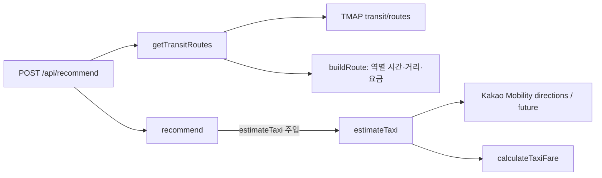

# 설계: 지하철(TMAP 대중교통)·택시(카카오모빌리티) 외부 API 연동

추천 로직 파트에 넘기는 데이터의 필드, 단위, 계산 방법은 `handoff.md`에 정리했다. 이 문서와 다르면 `handoff.md`를 기준으로 한다.

## 결정 기록

### D1. 출발 시각 기준 지하철 경로 API → **TMAP 대중교통** (2026-11-14 결정)
| 후보 | 출발 시각 | 중간역 | 요금 | 대체 경로 | 사용 가능 여부 |
|---|---|---|---|---|---|
| ODsay `searchPubTransPathT` | 없음 | 있음 | 있음 | 있음 | 키 삭제함(출발 시각 미지원으로 교체 결정) |
| 카카오모빌리티 대중교통 `multimodal` | 있음 | 있음 | 미확인 | 있음 | 불가: 제휴 전용, HTTP 403 `permission denied` |
| **TMAP 대중교통 `transit/routes`** | **`searchDttm`** | 있음 | 있음 | 있음(`count`) | 키 발급 필요. 무료 한도는 콘솔에서 확인 |

- ODsay 구현(`odsay.ts`)은 삭제한다. 역별 시간·거리·요금 계산은 API와 무관한 `build-route.ts`로 옮겨 그대로 쓴다.
- **실측 결과 (2026-11-14, 신촌역 → 코엑스)**: `searchDttm` 16:01과 다음 날 01:30의 응답이 경로 10개, 구간 시간까지 똑같았다. 다른 점은 구간별 `service`뿐이었다(16:01은 1, 01:30은 0). 즉 TMAP은 **그 시각 운행 여부(첫차·막차)만 반영하고, 열차 대기 시간이나 시간대별 소요시간은 반영하지 않는다.**
- 대응: `service` 0인 지하철 구간이 있는 경로는 버린다. 시간표 기준 대기 시간까지 필요하면 별도 시간표 데이터(예: 서울 열린데이터광장 역별 시간표)가 필요하다. 범위 밖으로 둔다.
- 무료 한도: **일 10건**(초과 시 자동 차단). 사용자가 제공한 SK Open API 요금표 기준.

### D2. 대체 경로 제공 → **선택 옵션으로 제공** (2026-11-14 결정)
- `getTransitRoutes`의 기본 동작은 `domain-rules.md`대로 경로 1개다.
- `options.maxRoutes`(최대 3)를 주면 추천 경로 뒤에 대체 경로를 붙인다. `routes[0]`이 항상 추천 경로다.
- 추천 로직에 대체 경로까지 넘길지(택시 호출 약 3배)는 팀이 정한다. 정하면 `domain-rules.md`를 먼저 고친다.

### D3. 노선 범위 → 수도권 1~9호선(급행 포함)만 (2026-11-14 결정)
모든 지하철 구간이 1~9호선인 경로만 쓴다. 신분당선, 경의중앙선, 공항철도 등이 섞인 경로는 버린다.

## 흐름


## transit (`src/features/transit`)

### TMAP 호출
```
POST https://apis.openapi.sk.com/transit/routes
appKey: {TRANSIT_API_KEY}
Content-Type: application/json
{ "startX": "경도", "startY": "위도", "endX": "경도", "endY": "위도",
  "lang": 0, "format": "json", "count": 10, "searchDttm": "yyyyMMddHHmm" }
```
- `searchDttm`은 `departureAt`(생략 시 현재 시각)의 Asia/Seoul 시각이다. 변환은 `shared/time.ts`의 `toKstStamp`를 쓴다.
- 환경변수 이름은 `TRANSIT_API_KEY`를 그대로 쓴다(`tech.md`, `shared/env.ts` 변경 없음).
- `count`는 10으로 요청한다. 실측에서 10개 중 지하철+도보 경로는 1개였다(나머지는 버스 포함). 응답의 `requestParameters.subwayCount`가 지하철 전용 경로 수다.

### 응답 변환 (순수 함수 `parseTmapRoutes`)
- 사용 필드: `metaData.plan.itineraries[]`의 `totalTime`(초), `fare.regular.totalFare`(원), `legs[]`
- `legs[]`: `mode`(`WALK`, `SUBWAY`, `BUS` 등), `sectionTime`(초), `distance`(m), `route`(노선명), `service`(1 운행, 0 미운행), `passStopList.stations[]`(`index`, `stationName`, `lon`, `lat`, `stationID`). 실측 응답은 `stations`이고 `stationList`도 받는다.
- 경로 선택 조건
  1. 모든 `leg.mode`가 `WALK` 또는 `SUBWAY`
  2. `SUBWAY`가 1개 이상
  3. 모든 `SUBWAY`의 `route`가 1~9호선
  4. 모든 `SUBWAY`의 `service`가 1(검색 시각에 운행)
- 조건을 만족하는 경로를 응답 순서대로 최대 `maxRoutes`개 쓴다. 응답 첫 순서를 추천 경로로 본다.
- 오류 응답: `result.status` 11~14(가까움, 정류장 없음, 결과 없음) → `NO_ROUTE`. `error` 객체, HTTP 401/403(키), 429(한도) → `UPSTREAM`.
- 숫자와 좌표는 문자열일 수 있으므로 zod `coerce`로 읽고, 모르는 필드는 무시한다.

### 역별 값 계산 (순수 함수 `buildRoute`, API 무관)
입력: 구간 목록(`walk` | `subway` | `other`, 분, 거리, 노선, 역 목록), 경로 요금, 총 시간.
- 구간 안 역 비율 = 역 사이 직선거리 누적 비율(좌표가 같으면 역 순서 비율)
- `elapsedMin` = 앞 구간 누적 시간 + 구간 시간 × 비율 (소수 1자리)
- `distanceM` = 앞 지하철 구간 누적 거리 + 구간 거리 × 비율. 구간 거리가 없으면 직선거리 합
- `fare` = `calculateSubwayFare(distanceM)`, 경로 요금 이하. 탑승역 0, 마지막 역은 경로 요금
- 환승역은 먼저 나온 것만 남긴다. `transferCount` = 지하철 구간 수 − 1
- 지하철 요금 상수(`transit/fare.ts`): 기본 1,550원(10km), 50km까지 5km마다 100원, 이후 8km마다 100원. 출처: https://world.seoul.go.kr/policy/transportation/modes-of-transport/subway/

### 캐시
같은 출발지, 목적지, 출발 시각(10분 단위)은 10분간 캐시한다. 요청의 `searchDttm`은 처음 호출한 시각 그대로다. 일 10건 한도 때문에 분 단위 캐시에서 바꿨다. 응답 전체(최대 3개 경로)를 캐시하고 `maxRoutes`로 잘라서 돌려준다.

### 오류
| 상황 | 오류 코드 |
|---|---|
| TMAP `result.status` 11~14, 조건을 만족하는 경로 없음 | `NO_ROUTE` |
| HTTP 오류, 타임아웃(5초), TMAP `error` 객체, 인증 실패, 한도 초과 | `UPSTREAM` |
| 응답 형식이 예상과 다름 | `UPSTREAM` |
| 환경변수 누락 | `requireEnv`의 오류 그대로 |

## taxi (`src/features/taxi`)

### 카카오모빌리티 호출
```
GET https://apis-navi.kakaomobility.com/v1/directions
  ?origin={x},{y}&destination={x},{y}&priority=RECOMMEND&summary=false
Authorization: KakaoAK {KAKAO_REST_API_KEY}
```
- 좌표 순서는 `경도,위도`다.
- `routes[0].result_code !== 0`이면 `NO_ROUTE`(도로 없음 등)로 던진다.
- `summary.distance`(m), `summary.duration`(초), `sections[].roads[]`의 `distance`, `duration`을 쓴다. `fare`는 읽지 않는다.
- (개정) 저속 구간 시간을 구하려고 `summary=false`로 호출한다.
- (개정) 탑승 시각 반영: `boardingAt`이 지금부터 5분보다 뒤면 `GET /v1/future/directions?departure_time=yyyyMMddHHmm`(Asia/Seoul, 5분 단위 올림)을 쓴다. 응답 형식은 실시간 길찾기와 같다. 계산은 `taxi/departure.ts`의 순수 함수에 둔다.

### 호출 수 제한
- `limiter.ts`의 `Limiter`(최대 동시 5)로 호출을 감싼다.
- `MemoryCache.getOrLoad`가 같은 좌표쌍의 동시 호출을 하나로 합친다. 캐시에는 도로 정보(거리, 시간, 저속 시간)만 두고, 요금은 탑승 시각마다 계산한다.

### 요금 (`fare.ts`, 개정)
서울시 중형택시 요금, 2023-02-01 04:00 적용. 출처: https://english.seoul.go.kr/policy/transportation/modes-of-transport/taxi/

| 시간대(Asia/Seoul, 탑승 시각) | 기본요금(1.6km) | 131m 또는 30초당 |
|---|---|---|
| 04~22시 | 4,800원 | 100원 |
| 22~23시, 02~04시 (20%) | 5,800원 | 120원 |
| 23~02시 (40%) | 6,700원 | 140원 |

- 동시병산: 시속 15.72km(=131m/30초) 미만 도로 구간의 시간 합 `slowSec`를 구하고, 저속 1초를 131/30m로 바꿔 주행거리에 더한다.
  `미터거리 = distance + slowSec × 131 / 30`, `요금 = 기본요금 + ceil((미터거리 − 1600) / 131) × 단위요금`, 10원 단위 반올림.
- 저속 판단은 도로 구간별 `distance × 30 < 131 × duration`(나눗셈 없는 비교).
- 다루지 않는 것: 시계 외 할증(서울 밖은 범위 밖), 통행료, 운행 중 시간대 변경(탑승 시각 요금표를 끝까지 적용).
- `TaxiEstimator`에 선택 인자 `boardingAt`을 추가했다. 생략하면 현재 시각이다.

### 실측 비교 (2026-11-14 주간, 신촌→코엑스 경로의 역 11곳)
우리 계산과 카카오 자체 예상 요금(`fare.taxi`, 참고용) 차이는 −7%~+15%다. 둘 다 추정이며 실제 미터 요금은 신호, 정체 등 실제 주행에 따라 달라진다.

## 생성/수정할 파일 목록
| 구분 | 파일 | 비고 |
|---|---|---|
| 신규 | `src/features/transit/tmap.ts` | TMAP 응답 zod 스키마, `parseTmapRoutes`, `isSeoulLine1to9` |
| 신규 | `src/features/transit/tmap.test.ts` | 샘플·실제 응답 변환, 경로 필터, 운행 여부, 오류 테스트 |
| 신규 | `src/features/transit/__fixtures__/*.json` | TMAP 실제 응답 2건(16:01, 다음 날 01:30) |
| 신규 | `src/features/transit/build-route.ts` | 구간 목록 → `Route`(역별 시간·거리·요금) |
| 신규 | `src/features/transit/build-route.test.ts` | 역별 값 계산 테스트 |
| 삭제 | `src/features/transit/odsay.ts`, `odsay.test.ts` | TMAP으로 교체(D1) |
| 신규 | `src/features/transit/errors.ts` | `TransitError` |
| 수정 | `src/features/transit/service.ts` | TMAP 호출, `departureAt`, `maxRoutes` |
| 수정 | `src/features/transit/index.ts` | `TransitError`, 옵션 타입 export |
| 신규 | `src/features/transit/fare.ts`, `fare.test.ts` | 지하철 거리비례 요금 |
| 신규 | `src/features/taxi/kakao.ts`, `kakao.test.ts` | 카카오 응답 파싱 |
| 신규 | `src/features/taxi/limiter.ts`, `limiter.test.ts` | 동시 호출 제한 |
| 신규 | `src/features/taxi/errors.ts` | `TaxiError` |
| 수정 | `src/features/taxi/service.ts` | 카카오 실시간·미래 길찾기 |
| 수정 | `src/features/taxi/fare.ts`, `fare.test.ts` | 동시병산, 심야 할증 |
| 신규 | `src/features/taxi/departure.ts`, `departure.test.ts` | 실시간/미래 길찾기 선택 |
| 수정 | `src/features/taxi/index.ts` | `TaxiError` export |
| 신규 | `src/shared/time.ts`, `time.test.ts` | `toKstStamp`(transit, taxi 공용) |
| 수정 | `src/shared/types.ts` | 선택 필드 추가(공통 파일 변경 요청 3, 5) |
| 수정 | `.kiro/steering/tech.md` | 대중교통 API를 TMAP으로 확정 |
| 신규 | `.kiro/specs/subway-taxi-api/handoff.md` | 인계 문서 |

`transit/fake-data.ts`는 다른 담당자가 참조할 수 있어 삭제하지 않는다.

## 공통 파일 변경 요청 (담당자가 구현)
1. `app/api/recommend/route.ts`: `TransitError`/`TaxiError`의 `code`로 응답을 나눈다(경로 없음 → 404, 외부 API 오류 → 502, 설정 누락 → 500).
2. `app/api/recommend/route.ts`: 서울 밖 출발지와 목적지 거절(`domain-rules.md`)이 아직 없다.
3. (이 브랜치에서 적용함) `src/shared/types.ts`: `TaxiEstimator`에 선택 인자 `boardingAt?: Date`, `TaxiEstimate`에 `slowSec?`, `surchargeRate?`, `trafficBasis?`.
4. `.env.example`: 변경 없음. `TRANSIT_API_KEY`에 TMAP `appKey`를 넣는다.
5. (이 브랜치에서 적용함) `src/shared/types.ts`: `Stop.line?`, `Stop.distanceM?`, `Stop.fare?`, `Route.totalMin?`, `Route.transferCount?`, `Route.timeAware?`, `Route.departureTime?`. 신규 `src/shared/time.ts`.
6. `recommend.ts` (recommender 담당): `const subwayFare = stop.fare ?? (index === 0 ? 0 : route.fare);`
7. `recommend.ts` (recommender 담당): 택시 탑승 시각 전달
   ```ts
   const boardingAt = new Date(departureAt.getTime() + (stop.elapsedMin + TAXI_WAIT_BUFFER_MIN) * MIN_MS);
   const taxi = await estimateTaxi(stop, destination, boardingAt);
   ```
8. `app/api/recommend/route.ts`: 지하철도 출발 시각 기준으로 찾도록 `departureAt`을 넘긴다.
   `const routes = await getTransitRoutes(origin, destination, departureAt);`

## 리스크
- TMAP 응답 구조는 실제 응답 2건으로 확정했다. 응답은 `transit/__fixtures__/`에 저장해 테스트에 쓴다(지도용 좌표 `passShape`는 제외).
- **TMAP 무료 한도 일 10건.** 개발 중 호출과 데모 촬영을 합쳐 10건이다. 메모리 캐시는 서버를 재시작하면 사라진다. 촬영 전에는 호출을 아끼고, 같은 출발지·목적지를 반복 검색해 캐시를 쓴다.
- 대체 경로: 실측 구간에서 TMAP의 지하철+도보 경로는 1개뿐이었다. 1~9호선 대체 경로는 구간에 따라 없을 수 있다.
- 후보 역이 약 30개면 카카오 호출이 30회다. 동시 5개 제한과 캐시로 줄인다.
